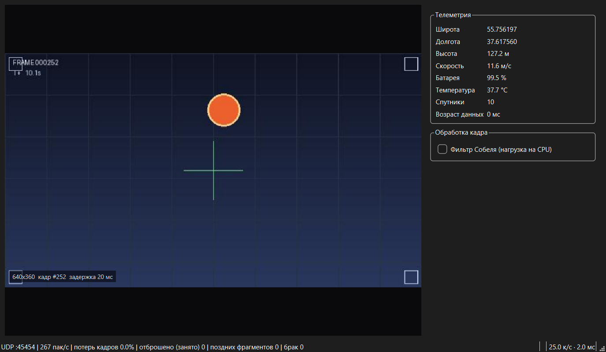
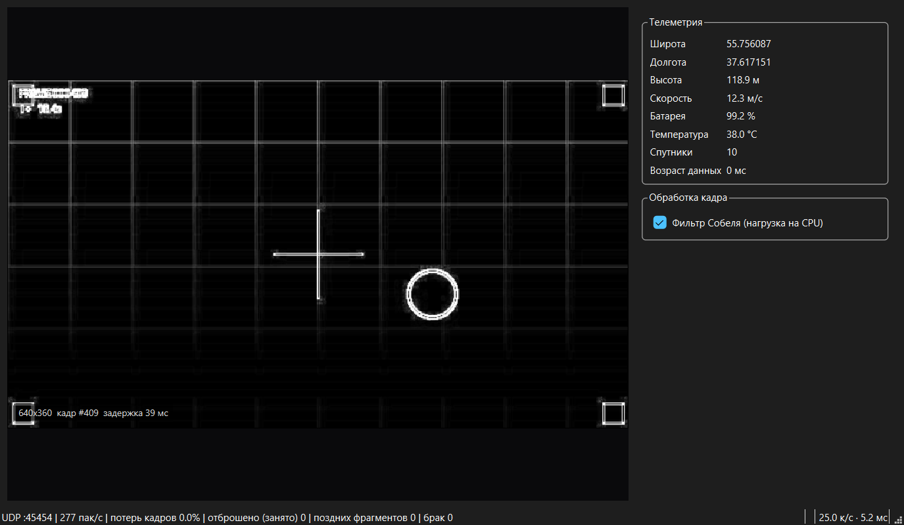
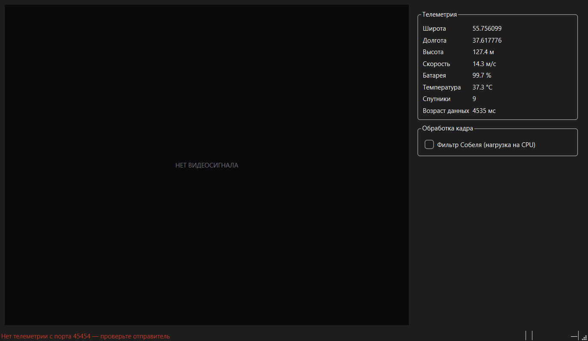

# Телеметрия и видео по UDP на Qt6 — учебный пример

Небольшое, но «как в жизни» устроенное приложение: принимает по UDP телеметрию и
видеокадры, обрабатывает их в отдельном потоке и показывает в окне.



Слева — принятый кадр (640×360, JPEG, порезанный на UDP-пакеты), справа —
телеметрия, в строке состояния — счётчики канала. Внизу слева на видео — плашка
«кадр #252, задержка 20 мс», справа внизу — 25.0 к/с и 2.0 мс на обработку.



Тот же поток с включённым фильтром Собеля: интерфейс остаётся отзывчивым, потому
что фильтр считается в рабочем потоке, а не в потоке GUI.

---

## 1. Запуск

### Вариант A. MSYS2 (так собрано здесь)

```powershell
# один раз: Qt6 + компилятор
C:\msys64\usr\bin\pacman.exe -S --needed mingw-w64-ucrt-x86_64-qt6-base

# сборка
.\build.cmd

# запуск окна вместе с генератором тестового потока
.\run.cmd
```

`.cmd`-обёртки нужны потому, что PowerShell по умолчанию не даёт запускать
неподписанные `.ps1`. Если политика у вас ослаблена, можно и напрямую:
`.\build.ps1`.

`run.cmd` поднимает отправитель и ждёт, пока вы закроете окно; его вывод пишется
в `sender.log` и `sender.err.log`. Нужен только приёмник (например, с реального
борта) — `.\run.cmd -NoSender`.

### Вариант B. Qt Creator / официальный Qt

Открыть `CMakeLists.txt` как проект, выбрать kit (Qt 6.x, MSVC или MinGW) и
нажать Run. Ничего дополнительно настраивать не нужно.

### Вариант C. Свой Qt из командной строки

```powershell
cmake -S . -B build -DCMAKE_PREFIX_PATH=C:/Qt/6.7.0/msvc2019_64
cmake --build build --config Release
```

Для тестового потока нужен Python с Pillow (`pip install pillow`):

```powershell
python tools/fake_sender.py                       # 127.0.0.1:45454, 25 к/с
python tools/fake_sender.py --loss 0.02           # 2% потерянных пакетов
python tools/fake_sender.py --reorder 0.15 --fps 10
```

Приёмник без отправителя тоже полезен: он честно покажет «НЕТ ВИДЕОСИГНАЛА» и
красным — «нет телеметрии».

Полезные флаги:

```powershell
--transport spsc     # вариант 2: SPSC-очередь + батчинг (см. раздел 7)
--edges              # включить фильтр Собеля сразу
--slow 150           # искусственная задержка обработки, мс (демонстрация перегрузки)
--screenshot f.png --after 5   # снять окно в файл и выйти
```

---

## 2. Главная мысль: три потока, и каждый занят своим делом

```
 ┌──────────────────────────── поток сети ────────────────────────────┐
 │ UdpReceiver: QUdpSocket → разбор заголовка → сборка кадров         │
 │ сигнал frameReceived(VideoFrame)                                   │
 └───────────────────────────────┬────────────────────────────────────┘
                                 │ Qt::QueuedConnection (копия данных)
 ┌───────────────────────────────▼────────────────────────────────────┐
 │ поток обработки: FrameProcessor                                     │
 │ JPEG-декод → (опционально) Sobel → QImage                          │
 │ сигнал frameReady(QImage), сигнал frameProcessed (подтверждение)   │
 └───────────────────────────────┬────────────────────────────────────┘
                                 │ Qt::QueuedConnection
 ┌───────────────────────────────▼────────────────────────────────────┐
 │ поток GUI: MainWindow, VideoWidget                                  │
 │ QImage → QPixmap → paintEvent → экран                              │
 └────────────────────────────────────────────────────────────────────┘
```

Почему именно так, а не «всё в одном `main`»:

| Поток | Что там происходит | Что будет, если делать это в GUI |
|---|---|---|
| GUI | отрисовка, реакция на мышь и клавиатуру | — |
| Сеть | `readDatagram`, разбор пакетов, склейка | окно «замирает» на время чтения пачки пакетов; при 3000 пак/с — постоянно |
| Обработка | декод JPEG, фильтры, детекторы | каждые 40 мс интерфейс не отвечает 5–20 мс — движение мышью и перерисовка дёргаются |

Ключевая идея Qt: **потоки общаются не общими переменными, а сигналами**. Если
объекты живут в разных потоках, соединение автоматически становится
`Qt::QueuedConnection`: сигнал кладёт в очередь получателя событие с копией
аргументов, а слот выполняется уже в потоке получателя. Никаких мьютексов на
каждой картинке не нужно — данные передаются по значению.

---

## 3. Путь одного кадра по шагам

1. **Пакеты пришли.** Сокет в потоке сети получает `readyRead`.
   `UdpReceiver::onReadyRead` вычитывает *все* ожидающие дейтаграммы в цикле —
   если прочитать одну, сигнал может не прийти снова, пока буфер не опустеет.
2. **Разбор заголовка.** `proto::decodeHeader` проверяет магию `TLM1` и что
   `payloadBytes` не обещает больше, чем реально пришло. Мусор от чужих
   приложений на том же порту отсекается здесь.
3. **Склейка.** `handleVideoFragment` кладёт кусок в `Assembly` по номеру кадра:
   `parts[fragIndex] = payload`. Когда собраны все `fragCount` частей —
   `deliverFrame` склеивает их, отрезает 8 байт метки времени и отдаёт
   `VideoFrame` наружу.
4. **Кадр ушёл в обработку.** `emit frameReceived(frame)` → очередь потока
   обработки → `FrameProcessor::processFrame` (уже в другом потоке).
5. **Обработка.** `QImage::fromData(..., "JPG")` — декод; при включённом
   фильтре — Sobel. Результат: готовый `QImage`.
6. **Показ.** `emit frameReady(image, ...)` → `MainWindow::onFrameReady` (поток
   GUI) → `VideoWidget::setFrame` → `update()`.
7. **Отрисовка.** `paintEvent` вписывает картинку в окно с сохранением пропорций
   и рисует её. `QImage` → `QPixmap` конвертируется здесь, потому что `QPixmap`
   привязан к графической подсистеме и в других потоках не работает.

Обратите внимание: **ни в одном месте нет `sleep`, `waitForReadyRead` или
`QApplication::processEvents()`**. Всё асинхронное: сокет живёт на цикле событий
своего потока, работа приходит событиями, результат уходит событиями.

---

## 4. Протокол

Один UDP-порт, один заголовок на все типы пакетов (20 байт, little-endian):

| Смещение | Размер | Поле | Смысл |
|---|---|---|---|
| 0 | 4 | `magic` | `0x314D4C54` («TLM1») — отсечь чужие пакеты |
| 4 | 2 | `type` | 1 — телеметрия, 2 — фрагмент видео |
| 6 | 2 | `flags` | зарезервировано |
| 8 | 4 | `frameId` | номер кадра / счётчик телеметрии |
| 12 | 2 | `fragIndex` | индекс фрагмента |
| 14 | 2 | `fragCount` | сколько фрагментов в кадре |
| 16 | 4 | `payloadBytes` | длина полезной нагрузки |

Телеметрия — JSON в payload. Видео — JPEG, порезанный на куски по 1200 байт;
внутри склеенного payload первые 8 байт — время отправителя (нужно для
измерения сквозной задержки).

Почему 1200, а не «сколько влезет»: типичный MTU — 1500 байт, минус IP и UDP
заголовки, остаётся 1472. Если отправить больше, пакет фрагментируется на уровне
IP, и потеря *одного* куска убивает весь пакет. Своя нарезка на 1200 байт даёт
предсказуемое поведение и позволяет видеть потери по фрагментам.

---

## 5. Пять мест, где спотыкаются почти все

### 5.1. Сокет должен жить в том потоке, который его создал

`UdpReceiver` создаётся в потоке GUI, затем `moveToThread`. Поэтому сокет
создаётся **не в конструкторе**, а в `start()`, который вызывается по сигналу
`QThread::started` — уже в новом потоке. Создай `QUdpSocket` в конструкторе —
и он останется привязанным к потоку GUI, а его сигналы будут приходить не туда,
где вы ждёте.

### 5.2. `QPixmap` — только в потоке GUI

`QImage` — это просто пиксели в памяти, его можно гонять между потоками.
`QPixmap` — ресурс графической подсистемы, он привязан к потоку. Рабочий поток
отдаёт `QImage`, `paintEvent` превращает его в `QPixmap`.

### 5.3. Свои типы надо регистрировать

`QueuedConnection` копирует аргументы через мета-систему. Для `Telemetry`,
`VideoFrame`, `RxStats` в `main.cpp` стоит `qRegisterMetaType`. Без этого Qt
напечатает предупреждение, а слот не вызовется — и вы будете час искать, почему
«сигнал вроде есть, а данных нет».

### 5.4. Не блокировать цикл событий

`waitForReadyRead()`, `QThread::sleep`, `QEventLoop::exec()` в слоте потока
сети — и поток перестаёт принимать пакеты, потому что `readyRead` некому
обрабатывать. Всё, что ждёт, — на таймерах и сигналах.

### 5.5. Останавливать объекты в их потоке

В `MainWindow::stopThreads` сначала `invokeMethod(stop, BlockingQueuedConnection)`
— сокет и таймеры закрываются в потоке приёмника, — и только потом `quit()` и
`delete`. Если удалить объект с активными таймерами из чужого потока, Qt
напечатает `Timers cannot be stopped from another thread`.

---

## 6. Backpressure: почему нельзя просто «принять и положить в очередь»

Кадры приходят быстрее, чем обрабатываются (или интерфейс подвис), и наивная
схема «сигнал на каждый кадр» копит очередь: память растёт, задержка растёт,
в итоге вы смотрите видео десятисекундной давности.

Здесь сделано так (см. `UdpReceiver::deliverFrame` и `FrameProcessor::frameProcessed`):

- приёмник отправляет кадр обработчику и **ждёт подтверждения**;
- пока подтверждения нет, новые кадры **отбрасываются** (`framesDroppedBusy`);
- если обработчик молчит дольше 2 секунд, блокировка снимается — иначе одна
  ошибка навсегда замораживает поток.

Для видео это правильная стратегия: свежий кадр важнее всех предыдущих. Для
телеметрии так делать нельзя — её надо либо всю, либо с явной пометкой пропуска.

Дополнительно отбрасываются недособранные кадры (потерялся фрагмент — ждать
бессмысленно, `kAssemblyTimeoutMs`), а фрагменты уже показанного кадра считаются
поздними и не принимаются.

Это один из двух возможных механизмов. Второй — не подтверждения, а
ограниченная очередь, которая просто не принимает кадр, когда полна: см.
раздел 7 (вариант с SPSC-кольцом). Обратная связь «по цепочке» точнее, очередь
проще и предсказуемее, но добавляет задержку на глубину буфера.

---

## 7. Вариант 2: SPSC-очередь + батчинг

В проекте два транспорта кадра «сеть → обработка», и переключаются они флагом:

```powershell
.\run.cmd                                  # вариант 1: сигналы (по умолчанию)
.\build\simple-io-app.exe --transport spsc # вариант 2: кольцо + батчинг
```

Код варианта 2 — четыре файла, специально отдельных, чтобы их можно было
сравнить с `FrameProcessor`:

| Файл | Роль |
|---|---|
| `src/SpscQueue.h` | кольцевой буфер без блокировок: один пишет, один читает |
| `src/SpscChannel.h` | очередь + семафор (уведомление) + статистика |
| `src/FrameQueueProducer.h/.cpp` | сторона сети: положить кадр и разбудить |
| `src/BatchFrameProcessor.h/.cpp` | сторона обработки: свой цикл, забирает пачками |

Что меняется по сравнению с сигналами:

| | Вариант 1: сигналы | Вариант 2: SPSC |
|---|---|---|
| Передача кадра | `emit` + `QueuedConnection` | `tryPush` в кольцо |
| Стоимость на элемент | ~0.6–1.1 мкс, `malloc` на событие | ~0.15 мкс, без аллокаций |
| Очередь | очередь событий Qt, растёт неограниченно | кольцо фиксированного размера |
| Backpressure | подтверждение от обработчика (лишние кадры не отправляются) | переполнение кольца (лишние кадры отбрасываются) |
| Поток обработки | цикл событий Qt + слот | свой цикл + блокировка на семафоре |
| Смена режима обработки | `invokeMethod(..., QueuedConnection)` | атомик, без очереди |
| Наружу (в GUI) | сигнал | тот же сигнал |
| Когда выбирать | до ~10 тыс. событий/с, важна простота | сотни тысяч событий/с, важна предсказуемость |

Главное отличие в коде — три строки. Producer:

```cpp
if (!m_channel->queue.tryPush(frame)) {                 // не влезло — теряем
    m_channel->stats.droppedFull.fetch_add(1);
    return;
}
m_channel->ready.release();                              // «проснись, есть работа»
```

Consumer:

```cpp
if (!m_channel->ready.tryAcquire(1, kIdleCheckMs)) continue;
quint32 batch = 1;
proto::VideoFrame next;
while (batch < kMaxBatch && m_channel->ready.tryAcquire()) {  // добираем пачку
    if (!m_channel->queue.tryPop(next)) break;
    frame = std::move(next);                                  // нужен самый свежий
    ++batch;
}
```

### Что видно на практике

Оба варианта можно поставить в одинаково тяжёлые условия — искусственная
задержка обработки кадра 150 мс (`--slow 150`, это примерно в 4 раза медленнее,
чем приходит поток):


Слева (вариант 1): отказался принимать 150 кадров — «отброшено (занято) 150»,
потому что обработчик занят и подтверждения нет. Справа (вариант 2):
«в очереди 1/7, сброшено 0, пачек 53, макс. 4» — кольцо накопило пачку, и
обработчик забирает по 3–4 кадра за пробуждение вместо одного.

При этом у второго варианта выше задержка (291 мс против 199 мс): очередь — это
буфер, и его глубина напрямую превращается в задержку. Восемь кадров при 25 к/с —
до +320 мс. Поэтому глубина кольца — это выбор бюджета задержки, а не «чем
больше, тем лучше».

### Цена вопроса

Замер (`bench/signal_bench.cpp`, собирается с `-DSIMPLE_IO_BENCH=ON`):

| Способ передачи | На элемент |
|---|---|
| `direct`-соединение (внутри потока) | 27 нс |
| `queued` сигнал, `int` | 620 нс |
| `queued` сигнал, 1 КБ | 1 100 нс |
| **SPSC, `int`** | **170 нс** |
| **SPSC, 1 КБ** | **150 нс** |
| `queued` сигнал, пачка 100×1 КБ | 12 нс |
| **SPSC, пачка 100×1 КБ** | **46 нс** |

Вывод, который стоит вынести: **разница между вариантами — в разы, а выигрыш от
батчинга — в десятки раз, и доступен он в обоих**. Если у вас меньше ~10 тыс.
событий в секунду, берите сигналы: кода меньше, отлаживать проще. Если больше —
кольцо, но и там пачки важнее, чем сам механизм передачи.

---

## 8. Надёжность и наблюдаемость

В учебных примерах обычно всё «идеально», и это главная разница с реальным ПО.
Здесь специально есть:

- проверка магии и длины пакета — мусор с порта не ломает парсер;
- счётчики: пакеты/с, потери кадров, отброшенные из-за занятости, поздние
  фрагменты, брак;
- watchdog: если телеметрия не приходила 1.5 с, статус краснеет и пишет «нет
  телеметрии»; если 1.5 с нет кадров, видео гаснет в «НЕТ ВИДЕОСИГНАЛА» — а не
  показывает вечно последний кадр, как это обычно и выглядит в учебных примерах;
- ограничение одновременных сборок (`kMaxAssemblies`), чтобы поток мусора не
  съел память.



Так выглядит приёмник через несколько секунд после остановки отправителя:
последние значения телеметрии остались (с возрастом 4.5 с), но и статус, и
видео честно говорят, что данных больше нет.

Проверить это можно, не трогая код: `python tools/fake_sender.py --loss 0.05`.
Потери кадров будут заметно выше 5%: при 11 фрагментах в кадре потеря 5%
пакетов убивает около половины кадров — это нормальная арифметика UDP.

---

## 9. Структура проекта

```
CMakeLists.txt            сборка, Qt6 Widgets+Network
build.cmd / build.ps1     сборка (cmd-обёртка обходит политику PowerShell)
run.cmd / run.ps1         запуск окна + генератор тестового потока
src/
  Protocol.h              формат пакетов, структуры данных, Q_DECLARE_METATYPE
  UdpReceiver.h/.cpp      сокет, парсинг, сборка кадров, счётчики
  FrameCodec.h/.cpp       декод JPEG и Sobel — общие для обоих вариантов
  FrameProcessor.h/.cpp   вариант 1: обработка в слоте на цикле событий Qt
  SpscQueue.h             вариант 2: кольцевой буфер без блокировок
  SpscChannel.h           вариант 2: очередь + семафор + статистика
  FrameQueueProducer.*    вариант 2: сторона сети (push + wake)
  BatchFrameProcessor.*   вариант 2: сторона обработки (свой цикл, пачками)
  VideoWidget.h/.cpp      показ кадра, aspect-fit, плашка
  MainWindow.h/.cpp       UI, создание потоков, соединения сигналов
  main.cpp                регистрация типов, разбор аргументов
bench/
  signal_bench.cpp        замер стоимости сигналов и SPSC (опция SIMPLE_IO_BENCH)
tools/
  fake_sender.py          генератор тестового потока (телеметрия + JPEG)
```

---

## 10. Как расширять под реальную задачу

- **Настоящее видео (H.264/H.265).** Вместо `QImage::fromData` — FFmpeg
  (`libavcodec`) или GStreamer в `FrameProcessor`. Логика та же: пакеты →
  декодер → кадр → сигнал в GUI. Для 1080p и выше отдавайте в GUI не `QImage`,
  а GL-текстуру (`QOpenGLWidget`, `QVideoFrame`).
- **Много источников** (несколько бортов/камер) — по потоку на источник или
  `QThreadPool` с ограничением параллелизма.
- **Более строгий протокол** — protobuf/flatbuffers вместо JSON, CRC в
  заголовке, окно последовательных номеров и подтверждения (как в RTP/RTCP).
- **Промышленный транспорт** — DDS (Fast DDS, Cyclone DDS), ZeroMQ, ROS 2:
  те же три стадии, но готовые механизмы QoS, обнаружения и надёжности.
- **Конфигурация и логи** — `QSettings`/JSON вместо констант, `QLoggingCategory`
  вместо `qInfo`.
- **Тесты** — `QTest` на парсер протокола и сборку кадров: это чистая логика без
  сети, её легко проверить юнит-тестами (главный аргумент за `Protocol.h`
  отдельным файлом).

---

## 11. Qt5 против Qt6

Код почти целиком переносится; что поменяется:

- `find_package(Qt6 ...)` → `Qt5`, `Qt6::Widgets` → `Qt5::Widgets`; в CMake для
  Qt5 может понадобиться `CMAKE_AUTOUIC`/`AUTORCC` (здесь не нужны);
- `QCheckBox::toggled(bool)` есть в обеих версиях — специально выбран он, а не
  `checkStateChanged` из 6.7;
- в Qt6 `QDataStream` по умолчанию версии 6 — при обмене с внешним кодом
  фиксируйте `setVersion()`;
- `QNetworkDatagram` есть с Qt 5.8 — если у вас совсем старый Qt, читайте через
  `readDatagram(buf, size, &addr, &port)`.

---

## 12. Проверка без ручного запуска

Приложение умеет снимать себя скриншотом — удобно для CI и для проверки, что
труба «сеть → обработка → показ» жива:

```powershell
.\build\simple-io-app.exe --screenshot shot.png --after 5
.\build\simple-io-app.exe --edges --screenshot shot_sobel.png --after 5
```

Консольная сборка с выводом `qInfo`/`qWarning`:

```powershell
cmake -S . -B build-console -DSIMPLE_IO_CONSOLE=ON
cmake --build build-console
.\build-console\simple-io-app.exe --port 45454
```

---

## 13. Что почитать дальше

- Qt: [Threads and QObjects](https://doc.qt.io/qt-6/threads-qobject.html) — про
  affinity, `moveToThread` и почему очередь событий важнее мьютексов.
- Qt: [Queued Connections](https://doc.qt.io/qt-6/qt.html#ConnectionType-enum).
- Qt: [QUdpSocket](https://doc.qt.io/qt-6/qudpsocket.html),
  [QImage](https://doc.qt.io/qt-6/qimage.html) vs
  [QPixmap](https://doc.qt.io/qt-6/qpixmap.html).
- Книга: *Qt 6 C++ GUI Programming Cookbook* или официальный
  [Qt Examples and Tutorials](https://doc.qt.io/qt-6/examples.html).

Если хочется «почувствовать» разницу, включите фильтр Собеля и посмотрите на
загрузку CPU: интерфейс не меняется, потому что тяжёлая работа ушла из GUI-потока.
Это и есть главный ответ на вопрос «как это всё сочетается».

